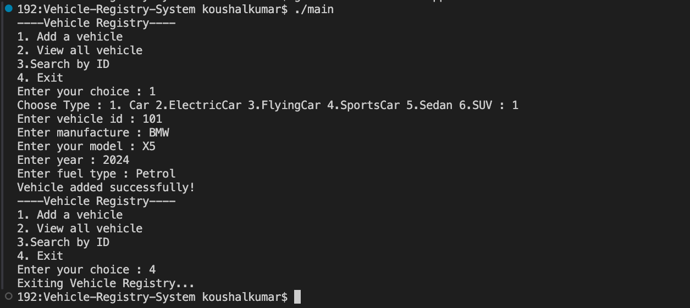

# 🚘 Smart Vehicle Registry System in C++

## Short Description

A menu-driven C++ application that allows users to add, display, and search for different types of vehicles using Object-Oriented Programming (OOP) concepts such as inheritance, constructors, encapsulation, and polymorphism through function overloading/overriding.

## About the Project

The **Smart Vehicle Registry System** is a console-based application developed using C++. It helps users maintain a basic record of vehicles by storing information such as vehicle ID, manufacturer, model, year, and fuel type.

The application supports multiple vehicle categories, including Car, ElectricCar, FlyingCar, SportCar, Sedan, and SUV. Each category can have additional attributes, such as battery capacity, flight range, or top speed.

Users can interact with the application through a menu to add vehicles, view all registered vehicles, and search for a vehicle using its ID.

## Features

- **Add a Vehicle:** Register a vehicle with its ID, manufacturer, model, year, and fuel type.
- **Multiple Vehicle Types:** Supports Car, ElectricCar, FlyingCar, SportCar, Sedan, and SUV.
- **Electric Car Details:** Store additional battery capacity information.
- **Flying Car Details:** Store additional flight range information.
- **Sports Car Details:** Store additional battery capacity and top speed information.
- **View All Vehicles:** Display the registered vehicle records.
- **Search by ID:** Search for a vehicle using its unique ID.
- **Menu-Driven Interface:** Navigate through the application using numbered options.
- **Object-Oriented Design:** Organize vehicle data using classes and inheritance.

## Technologies Used

* C++
* Visual Studio Code
* G++ Compiler
* Github

## C++ Concepts Used

- **Classes and Objects:** Define vehicle categories and create vehicle objects.
- **Encapsulation:** Keep data members private and access them through public member functions.
- **Inheritance:** Reuse properties and methods from the base `Vehicle` class.
- **Multilevel Inheritance:** Implement relationships such as `Vehicle → Car → ElectricCar → SportCar`.
- **Multiple Inheritance:** Create `FlyingCar` by inheriting from both `Car` and `Aircraft`.
- **Constructors:** Initialize objects using default and parameterized constructors.
- **Destructors:** Manage the vehicle counter when `Vehicle` objects are created and destroyed.
- **Static Data Members:** Maintain a shared `totalVehicles` counter.
- **Getter and Setter Methods:** Access and modify private data members.
- **Function Overriding:** Provide specialized `display()` methods in derived classes.
- **Arrays:** Store vehicle records in an array.
- **Conditional Statements:** Use `if`, `else if`, and `else` to handle menu selections.
- **Loops:** Use a `do-while` loop for the menu and `for` loops for displaying and searching records.
- **Standard Library:** Use `iostream` for input/output and `string` for text data.

## Requirements

* Visual Studio Code
* C++ compiler such as G++

# Installation

1. Install **VS Code**.
2. Install the **G++ compiler**.
3. Create a project folder.
4. Create a C++ file named `main.cpp`.
5. Write the program into `main.cpp`.

# How to Run

Open the VS Code terminal and run:

```bash
g++ main.cpp -o main
```

Then run the program:

```bash
./main
```

## Project Structure

```text
├── main.cpp
├── README.md
└── output.png
```

## Screenshots



## Future Improvements

- Store complete derived vehicle objects so that additional attributes such as fuel type, battery capacity, flight range, and top speed are preserved when displaying and searching records.
- Add a feature to delete vehicle records.
- Add a feature to update existing vehicle details.
- Validate vehicle IDs to prevent duplicate records.
- Save vehicle records to a file so that data remains available after the program exits.
- Improve the user interface and display formatting.

## Author

**Supriya Thakur**


